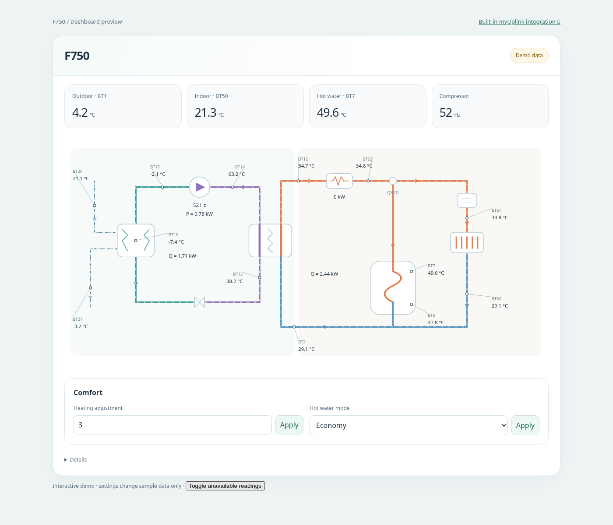

# NIBE F750 Dashboard

A Home Assistant custom Lovelace card for a NIBE F750 connected through **Home Assistant’s built-in myUplink integration**. No second API client, credentials, or polling loop. Initial version: monitoring and manual comfort controls; smart optimization is planned.



## First release

- Compact light dashboard with outdoor, indoor, hot-water and compressor readings. The diagram uses values beside the components and simple `Q = … kW` / `P = … kW` annotations. Extra readings, estimate notes and discovery settings are under **Details**.
- One combined refrigerant and hydraulic schematic with mapped temperatures and a shared condenser heat exchanger. Refrigerant and water paths stay separate. Static arrows show normal direction; animated air, refrigerant and water paths illustrate operation and reported heating/DHW priority. Motion is not a flow measurement. Compact BT sensor markers follow the [manual-based location guide](docs/schematic.md). On narrow cards and iPhone portrait screens, the schematic automatically becomes a vertical layout with heat recovery above heat distribution; no horizontal scrolling.
- Manual heating adjustment and hot-water mode through mapped `number` / `select` entities. Values and limits come from Home Assistant. Every write asks for confirmation and reports service errors.
- Automatic discovery by myUplink parameter ID, with a device-scoped measurement-name fallback for API variations (including `sensor.vp_current_compressor_frequency`). Renamed entities still match stable IDs or original names. No manual sensor list required.
- Diagram annotations show compressor P estimated with the supplied frequency/BT12 formula, sensible evaporator Q from reference airflow, and condenser Q derived as their sum. Corrupt water-flow readings are excluded. See [heat calculations](docs/heat-calculations.md).
- Missing entities show unavailable values. No guessed sensor IDs or fabricated live COP.
- Interactive standalone demo with clearly labeled sample data.

## Connect to Home Assistant

1. Set up [the built-in myUplink integration](https://www.home-assistant.io/integrations/myuplink/) under **Settings → Devices & services**. Connect your F750 to your myUplink account first. Enter OAuth credentials in Home Assistant, never in this card or the repository.
2. Available data and writable controls depend on the equipment, firmware, API and subscription. Some entities may need enabling. myUplink normally updates every 60 seconds; this is a cloud dashboard, not real-time telemetry.
3. Copy `dist/nibe-f750-card.js` to `/config/www/nibe-f750-card.js`.
4. Under **Settings → Dashboards → Resources**, add `/local/nibe-f750-card.js?v=0.10.0` as a **JavaScript module**. Enable Advanced Mode in your profile if Resources is hidden.
5. Add a manual dashboard card with just:

```yaml
type: custom:nibe-f750-card
```

The card discovers the built-in myUplink device, readings and supported comfort controls automatically. If several devices are present, it prefers a uniquely identified F750; otherwise choose a device in the card. Use a full-width panel view or a wide section for the circuit layout. **Details → Refresh discovery** rechecks registries after you enable entities. Registry access must be permitted for your Home Assistant account.

For HACS, add this repository as a custom **Dashboard** repository. `hacs.json` and the distributable file are included; this project is not listed in the default HACS catalog.

For an existing HACS installation, update/redownload the card and refresh your browser. Remove the old `entities:` and `controls:` configuration to enable automatic discovery. [Discovery details and source references](docs/discovery.md).

### Entity mapping

Manual mapping is an optional advanced override: providing `entities:` replaces automatic discovery. See [examples/dashboard.yaml](examples/dashboard.yaml). All `entities` keys are optional. `entities: {}` gives a read-only, unconfigured card. Units are taken from each entity's `unit_of_measurement` when present. Match the sensor's actual meaning; especially distinguish extract/discharge air, refrigerant temperatures and heating-water temperatures. The diagrams are explanatory, not an F750 service schematic and do not model valve positions or domestic-water plumbing in detail.

| Key | Meaning |
| --- | --- |
| `outdoor`, `room` | Outdoor and room temperature |
| `hot_water`, `hot_water_charge` | BT7 tank display and BT6 tank control temperatures, kept separate |
| `supply`, `return` | Heating-water flow and return temperatures |
| `exhaust_air`, `leaving_air` | Extract air before recovery and discharge air after recovery |
| `evaporator`, `condenser` | Evaporator and condenser refrigerant outlet (BT15 liquid line), if exposed |
| `compressor_frequency` | Compressor frequency in Hz (also drives diagram animation) |
| `heater_power` | Auxiliary electric heater power |
| `electrical_power`, `cop` | Optional measured input power and separately calculated/measured COP |
| `operation` | Reported operating mode |
| `condenser_water_out` | BT12 water outlet temperature, used with actual compressor frequency for estimated P |
| `hot_gas`, `suction` | BT14 compressor discharge and BT17 suction temperatures |
| `heating_supply`, `heating_return`, `heater_out` | BT61/BT62 after-buffer temperatures and BT63 after immersion heater |
| `air_flow` | BS1 airflow with volume/time units, for the sensible-only evaporator estimate |
| `reference_air_flow` | Automatically discovers `sensor.vp_reference_air_speed_sensor` and equivalents; takes precedence for a clearly labeled reference-airflow sensible evaporator Q estimate |

`controls.heating` and `controls.hot_water` each accept a writable `number.*` or `select.*` entity. Choose the actual heating offset / hot water comfort setting exposed by your installation. The card calls `number.set_value` or `select.select_option`; it never commands compressor speed directly. A successful service call means the command was sent, not that the heat pump has applied it. Verify the subsequent state. myUplink may require a paid subscription for writes.

## Preview and development

No frontend build or runtime dependencies:

```sh
python -m http.server 8080
# Open http://localhost:8080/demo/
node --check dist/nibe-f750-card.js
```

Browser checks: install Playwright (`npm install --no-save playwright` and `npx playwright install chromium`), then run `npm test` while the preview server is running. Checks cover mobile layout, unavailable readings, valid/invalid writes, confirmation cancellation and service failures. `PREVIEW_URL` can override the preview origin.

## Smart control roadmap

See [docs/smart-control.md](docs/smart-control.md). Automated control is not implemented in this release. First collect trustworthy telemetry and establish the writable capabilities of the specific F750 installation.

Independent community project; not affiliated with NIBE or myUplink. MIT licensed.
