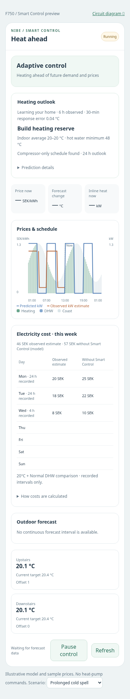

# Electricity history and weekly comparison (v0.18)

The Prices & schedule chart spans **12 hours before now and 12 hours after now**. Prices and heating/DHW schedule colours use the left scale (SEK/kWh); two power lines use the right scale (kW). Power points represent 15-minute intervals. Missing readings break the line. The observed line stops at the present; future consumption is a prediction.

Predictions are saved when issued, updated for future intervals and frozen after an interval begins. Historical predictions are not recalculated using today's model. If no forecast was recorded for a past interval, that part of the prediction line stays empty.

## Observed consumption

There is no dedicated F750 electricity meter. The observed line and cost therefore use **estimates from actual operating readings**, not metered electricity:

```
compressor kW = frequency Hz × [0.0161 + 0.000208 × (BT12 °C − 45)]
total kW = compressor kW + reported inline heater kW
```

This covers compressor and inline heater, not the whole home's electricity, fan or circulation-pump consumption. Reported zero compressor frequency gives zero compressor power. Missing/unavailable/stale inputs do not count as zero consumption. Minute observations are integrated by elapsed time and averaged into quarter-hours; long gaps and downtime are not bridged. Prices use the configured Nord Pool sensor's price basis, with explicit SEK/MWh or öre/kWh conversion where necessary. This is not a calculation of every item on the electricity bill.

## This week's costs

The separate area lists Monday–Sunday in Home Assistant's timezone. It shows accumulated estimated cost for recorded periods and a modelled **ordinary thermostat at 20°C with Normal DHW**, as requested. Days later this week are listed with blank values. Coverage is shown per day, so a partially recorded day is not mistaken for a full day.

The reference simulation uses the learned building heat loss, thermal capacity, heat delay, hot-water demand profile and compressor capacity, together with recorded outdoor temperature and the same historical electricity prices. It runs its own room/tank state, fixed-temperature heating demand, Normal hot-water charging and auxiliary support within the reported heater limit, without reacting to prices. It starts from observed temperatures at the start of each continuous recording period. Initial tank-temperature parameters follow the adaptive model settings; it cannot reproduce every native NIBE control decision, degree-minute behaviour or the owner's actual unobserved consumption in an alternative scenario.

**The reference is a counterfactual estimate, not measured savings.** Both columns are compared on the same recorded power/price periods. If required reference inputs are missing for part of a day's cost coverage, its comparison value stays blank. Neither incomplete data nor unknown heater limits are silently treated as zero load.

## History and installation

Update the integration through Marketplace, restart Home Assistant and refresh the browser. There is no new YAML, external service, dashboard configuration or NIBE setting to install. This feature adds no cloud writes and does not change the controller's write cadence.

History is persisted locally in Home Assistant storage. At first startup, an optional background Recorder query reconstructs available readings since the start of the week (or the past 12 hours, if earlier), and recovers previously recorded forecast attributes where available. It does not invent old predictions. Recorder-disabled/excluded/purged data and long recording gaps remain missing; new observations are still recorded normally. Backfill uses the currently learned model for the reference simulation and may therefore differ from a simulation that had been running since Monday. After import, completed historical costs are retained rather than rewritten each time the model learns.

The integration adds a **NIBE electricity history** sensor for the cards. It reports chart and weekly data in attributes; the controller records independently of whether a dashboard is open. The large rolling-chart attribute is excluded from Recorder duplication because its history already persists in the local accounting store. Calculation or Recorder failures are isolated from heating control.

The previews below use deterministic test data, not measurements from the owner's home.


