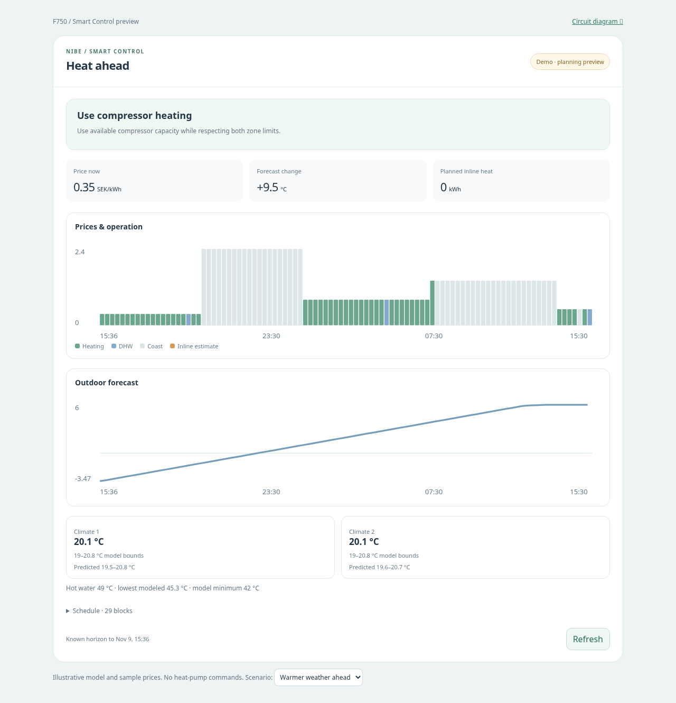

# Smart Control: separate planning card

For the new live backend, see [live control setup and write limits](live-control.md). The control uses current temperatures and price rules; the forecast planner below does not issue live commands.

The existing `nibe-f750-card` circuit diagram is unchanged. `nibe-f750-smart-card` includes a **read-only planning preview** with Home Assistant source adapters and a bounded optimizer, plus Pause/Resume for the separately installed control backend. The forecast planner itself does not apply offsets or change DHW mode. The backend runs with dashboards closed and requires disabling the old automations as described in the live control guide.



## Install the integrated component

Follow [the HACS Integration installation and migration guide](../README.md#install). Both cards are automatically served by the integration. The old external YAML backend is replaced by the integration's Python controller; remove it during migration.

The standalone `/demo/smart.html` is illustrative and issues no pump-setting calls.

## Sources: use Home Assistant integrations

**Weather:** use the built-in [SMHI integration](https://www.home-assistant.io/integrations/smhi/). Add it under Settings → Devices & services → Add integration → SMHI, choosing your home location. It needs no API key. The card calls `weather.get_forecasts` with `type: hourly`; SMHI's integration supplies its cached forecast. One SMHI weather entity is automatically preferred. When there are several, choose one under Sources & assumptions.

**Electricity:** the existing `sensor.nordpool_kwh_se3_sek_3_10_025` is preferred when present. If it exposes timestamped `raw_today` / `raw_tomorrow`, the card uses those lists. Numeric-only daily arrays are not assigned guessed timestamps. An explicitly false `tomorrow_valid` excludes tomorrow's rows.

For the [official Nord Pool integration](https://www.home-assistant.io/integrations/nordpool/), the card can instead call [`nordpool.get_prices_for_date`](https://www.home-assistant.io/actions/nordpool.get_prices_for_date/) for the current and next calendar day. The configuration entry ID comes from the selected entity registry row or explicit `nordpool_entry`. The action response uses currency/MWh, converted once to currency/kWh. Already-normalized custom-integration kWh values are not divided again. Nord Pool credentials are neither extracted nor sent to the browser.

The defaults SE3 and SEK reflect the entity supplied in this conversation. Override them for a different region/currency. Tomorrow's prices are used only when returned; service failures leave tomorrow unavailable, rather than filling in an assumed price.

Source options, if automatic selection is ambiguous:

```yaml
type: custom:nibe-f750-smart-card
weather_entity: weather.smhi_home
price_entity: sensor.nordpool_kwh_se3_sek_3_10_025
area: SE3
currency: SEK
horizon_hours: 24
# Optional for official Nord Pool when no price entity is available:
# nordpool_entry: YOUR_ENTRY_ID
# Optional if the price entity has an ambiguous unit:
# price_unit: SEK/kWh
```

The browser retrieves forecasts/prices and can toggle the backend enable helper using Pause/Resume. It never directly writes myUplink settings. The optional backend owns the bounded cloud writes.

## Tariff basis

Nord Pool base prices exclude VAT and supplier/network add-ons. Existing custom Nord Pool sensors may already include these. Do not add them twice. The displayed cost is a model cost on the explicitly configured basis, not a bill estimate or a claimed saving.

```yaml
tariff:
  vat_percent: 0
  extra_per_kwh: 0
```

Conversion: `(source_price_per_kwh + extra_per_kwh) × (1 + vat_percent / 100)`. Defaults preserve the source basis. Supported units: the selected currency/kWh or currency/MWh, and öre/kWh for SEK. Unsupported units require an explicit `price_unit`. Negative prices are valid; no price ratio or division by a daily minimum is used. Fixed monthly fees and demand-based tariffs are not optimized.

## Existing control captured from the supplied automations

- Every quarter-hour, the thermostat automation writes `sensor.thermostat_comp_c1/c2`, rounded to whole numbers, to the two `number.vp_heating_offset_climate_system_*` entities.
- Climate 1's target is 20°C for low prices, prices below 1.5, extract air below 18°C, or average outdoor below 2°C; otherwise it is 19°C. Climate 2's target is the smaller of the rounded-up upstairs temperature and climate 1's target.
- DHW is Normal from 22:00–06:00. Outside that period it changes to Economy only when price exceeds average and 1.5, daily minimum is positive, max/min is at least 1.3, and average outdoor exceeds 2°C.
- Thermostat writes run at second 0, DHW changes at second 5, and target updates at second 15. Thus an offset can be calculated from the preceding quarter's target.

These are **target-selection rules, not calibrated comfort limits**. The owner clarified that `sensor.thermostat_comp_c1` and `sensor.thermostat_comp_c2` are helpers storing requested offsets; they are not assumed to contain thermostat formulas. No new helpers or template definitions are needed to display this card. The preview monitors current targets, applied offsets and stored requests, and never disables the automations.

### C2 depends on C1

C1 supplies radiators. C2 is the low-temperature circuit, with its own mixing valve (shunt) and circulation pump, confirmed by the owner. Both draw from the common heat supply. The owner reports that independently raising C2 demand pulls the common supply temperature down, leaving C1's radiators too cold. A separate shunt and pump do not provide independent heat capacity.

The existing rule `C2 target = min(ceil(C2 room temperature), C1 target)` is intentional demand restraint, not an accidental dependency. Retain this rule when selecting price/weather-dependent targets: first choose C1's target, then derive C2's ceiling from it and C2's measured room temperature. C2 must not receive an independent price-driven preheat target. The live card displays this calculated ceiling alongside the actual helper target. Because rounding up can still allow almost 1°C of C2 room-temperature demand, this rule alone does not specify a heat-flow limit or prove a hydraulic balance.

The future controller must coordinate both circuits, preserve this demand restraint and avoid escalating compressor/inline heat to satisfy an independently boosted C2. Protect the supply temperature required by C1's radiators when admitting additional C2 demand. A persistent supply-temperature shortfall should prompt a review/restriction of C2 demand before being attributed to insufficient heat-pump capacity. The supply target, measurements, margins and response delays need validation; neither an arbitrary temperature threshold nor an unverified direct shunt/pump command is implied here. During DHW priority or other native operating transitions, a temporary heating-supply drop must not be treated as evidence of C2 taking too much heat.

The controller must also monitor both rooms for comfort; restricting C2 must not silently discard its comfort needs. If C2 approaches its comfort floor while C1's supply cannot be maintained, report a capacity/distribution conflict and replan the common heat supply rather than quietly overriding the dependency. Separate room-temperature requirements still matter, but the heat delivered to each circuit cannot be assumed independently available. Shunt behavior, flow response and supply/return behavior must inform the distribution model. The linked-target rule is already represented in the card; the control backend now adds a supply-shortfall guard (see the live guide), while the predictive physical distribution model remains to be implemented.

The demo's fixed `heat_share` split cannot represent C2 dominating the supply. **Live two-zone scheduling is therefore withheld**, with prices/weather and current control values still displayed, until a coupled distribution model is implemented. The demo remains an explicitly illustrative scheduling example, not a validated model of this installation.

## Planning model and policy

The engine uses a one- or two-zone heat-loss/storage model and one mixed hot-water storage model. Price rows are split at actual quarter-hour boundaries, including a partial first interval; durations are integrated in hours. UTC timestamps with explicit offsets preserve DST days and both hourly and quarter-hour markets. Missing price/weather intervals stop the continuous horizon. By default fewer than six known hours block a plan. The requested horizon is 24 hours; unknown tomorrow prices are never extrapolated.

For each zone: `C × dT/dt = Q_zone + internal_gain − H × (T_room − T_outdoor)`. This is integrated as a constant-input first-order thermal model over each interval. Heating output is divided by configured zone shares. SMHI outdoor temperature changes building heat demand. The F750's source is indoor exhaust air, so outdoor temperature is **not** used as an outdoor-source COP multiplier.

Compressor choices are off, low/high space heating and high DHW. Space heating and tank charging share the same compressor capacity; they are not allocated simultaneously. Heat-output capacities are explicit model parameters. Compressor electrical input uses the owner-supplied formula `f × [0.0161 + 0.000208 × (BT12 − 45)]`, with separate assumed water-outlet temperatures for heating/DHW. The previous diagram's sensible-only Q estimate is **not** silently treated as validated total heating capacity or COP.

The search respects both zone temperature bands, tank reserve, declared draw events, capacity limits and minimum on/off/mode dwell times. The terminal state must restore both zone targets and the tank target, avoiding an artificially cheap plan that drains reserves at the horizon boundary. Hot-water draw energy is subtracted before reheat in its interval, so the model cannot hide a reserve violation by reheating later in the same interval.

1. Search for a feasible **compressor-only** schedule and minimize electricity cost within it.
2. If none is found, widen that search before trying inline-heat candidates.
3. In the inline search, prioritize less auxiliary energy, then cost. Inline candidates respect the configured step size and the common heating/DHW destination.
4. If no candidate meets bounds, show an explicit infeasible status rather than relaxing comfort silently.

This is a **bounded beam search**, not a certified global optimum or proof that inline heat is physically unavoidable. It uses 0.05°C / 0.25°C state buckets for zone/tank deduplication, retains diverse storage states, and has a finite beam budget. Models, temperature/flow sensors, the empirical power curve and demand forecasts all have error. A result described as an inline candidate is for review, not an instruction to enable resistance heating.

## Model setup and current limits

Without `model:`, the live card can display prices/weather but does not invent a building model or generate a schedule. Current weather is used to bridge to the first forecast point only when the first point is within 90 minutes. Large forecast gaps and missing current temperatures block planning. The card automatically reads the newly confirmed `sensor.ovanvaning_temperature` for climate 1 and `sensor.nedervaning_temperature` for climate 2, and average BT6/BT7 for the tank. Optional `temperature_entity` per zone overrides room selection. Extract-air temperature is not silently treated as a room-temperature comfort sensor.

[`examples/smart-control/demo-model.json`](../examples/smart-control/demo-model.json) contains a complete **illustrative, uncalibrated** model for reproducing the demo. Copying it to a live card only produces a control simulation; it does not establish valid comfort or hot-water limits for the installation. All model numbers must be numeric YAML values.

Model fields:

- `zones`: one/two entries with `name`, optional `temperature_entity`, `loss_kw_per_k`, `capacity_kwh_per_k`, `min_c`, `max_c`, `target_c`, `heat_share`, and optional `internal_gain_kw`.
- `dhw`: `capacity_kwh_per_k`, `loss_kw_per_k`, `ambient_c`, `min_c`, `max_c`, `target_c`, plus optional `draws: [{at: ISO_TIMESTAMP_WITH_OFFSET, kwh: ENERGY}]`.
- Plant: `heat_low_kw`, `heat_high_kw`, `dhw_high_kw`, `low_hz`, `high_hz`, `supply_c`, `dhw_supply_c`, `inline_step_kw`, `min_on_minutes`, `min_off_minutes`, `min_mode_minutes`, and optional `min_horizon_hours` (default 6).

No wind/solar model, learned thermal inertia, defrost prediction, tariff demand-charge optimization or automatic fitting is claimed yet. The mixed-tank model does not resolve stratification or guarantee shower duration. Sensor freshness cannot be certified from frontend state timestamps alone. Live acquisition and planning are tested with Home Assistant-shaped fixtures, not against the owner's installation. Source calls refresh at most every 15 minutes while this card is open; failures clear the old plan.

## Next step toward automatic control

The control backend now owns serialized thermostat/DHW writes. Before allowing the forecast planner to drive those writes, a persistent predictive backend must own the replanning cycle, log predictions/outcomes, support a manual override and run a shadow-validation period. It needs the logic that updates the stored offset requests, the coupled circuit hydraulics and response, actual source/entity capability inventory, calibrated zone/capacity parameters, confirmed comfort/DHW constraints, and a safe mapping from abstract heat demand to allowed heating offsets and comfort modes. This first card deliberately does not guess those offsets.

Before forecast-driven writes, that predictive backend must handle stale/unavailable data, native safety and hot-water hygiene, native degree-minute behavior, operating limits, write permissions/subscription, cloud delay, and ownership conflicts with existing automations. Native heat-pump control should remain authoritative on failures. The current preview does not disable or bypass any of those functions.

## Validation

`npm test` includes the original diagram checks plus planner/source/UI checks for unit conversion, negative prices, DST timestamps, gaps, shared capacity, cold/warm demand, tank draws, terminal reserves, inline support, infeasibility, source errors, desktop/portrait rendering and absence of control writes.
